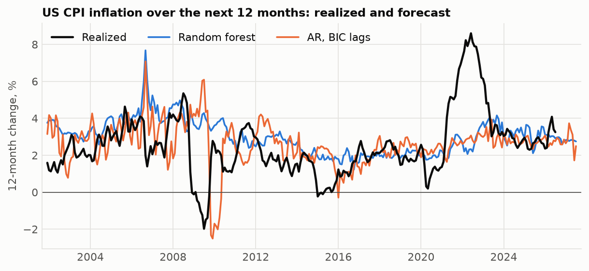
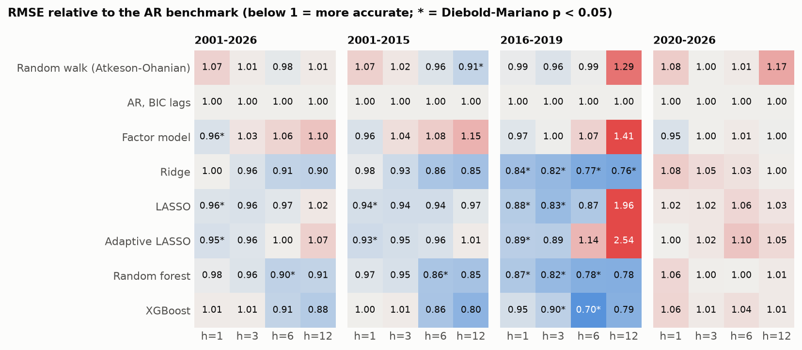
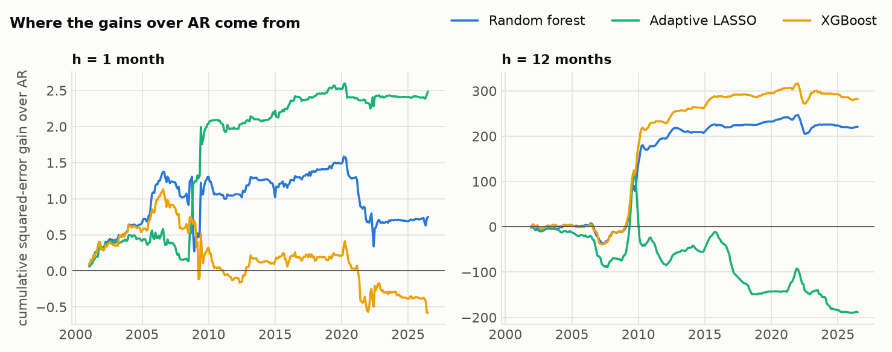
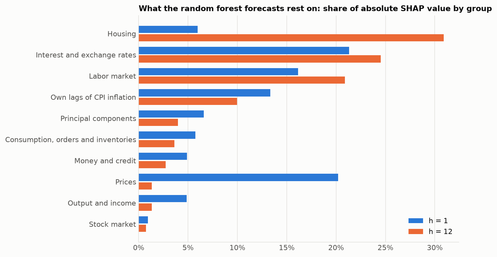
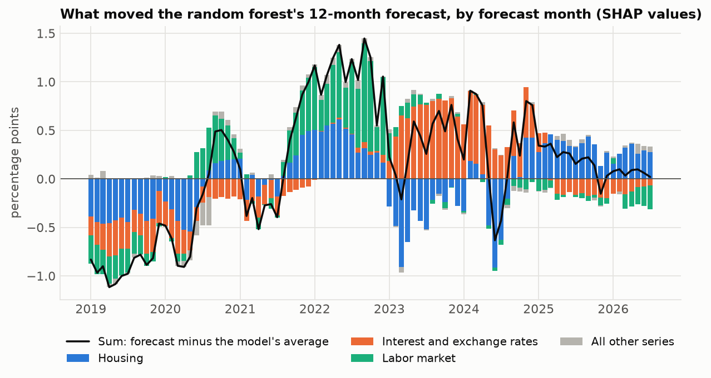

# ml-inflation-forecasting

**English** | [简体中文](README.zh-CN.md)

[](https://github.com/jackieyangjq/ml-inflation-forecasting/actions/workflows/ci.yml)

Can machine learning forecast US inflation better than a simple autoregression? This repository replicates the design of Medeiros, Vasconcelos, Veiga and Zilberman (2021), "Forecasting Inflation in a Data-Rich Environment: The Benefits of Machine Learning Methods" (*Journal of Business & Economic Statistics*), in Python on the latest FRED-MD data, and extends it in two ways: the evaluation runs to July 2026, through the pandemic and the 2021-2023 inflation surge, and every forecast of the tree models and the LASSO comes with a SHAP breakdown of which groups of series drove it.



## Results

308 monthly forecast origins, December 2000 to July 2026, 8 models, 4 horizons. Numbers are RMSE relative to the AR benchmark: 0.85 means 15% lower forecast error.

- **The paper's main finding holds on its own evaluation period.** In 2001-2015 the models that use all 121 series beat AR at 6 and 12 months: XGBoost's RMSE is 20% lower at 12 months, the random forest's and ridge's 15% lower. For both tree models the Diebold-Mariano test rejects equal accuracy with AR at the 10% level at 6 and 12 months (at 5% for the random forest at 6 months).
- **The random forest does not dominate.** The paper finds it better than every other model. Here it is one of the best three at 6 and 12 months, level with XGBoost and ridge, and the model confidence set cannot separate them.
- **Most of the 12-month gain came from one episode.** About two thirds of the 2001-2015 advantage of the random forest and XGBoost over AR at 12 months comes from forecasts made between mid-2008 and mid-2010. In December 2008 AR extrapolated the collapse in prices and forecast -2.5% for 2009; the random forest said 3.5%, XGBoost 2.6%; inflation came in at 2.8%.
- **From 2020 on, nothing beats AR.** Every ratio in 2020-2026 lies between 0.95 and 1.17. In June 2021 every model except the random walk put inflation over the next 12 months between 2.3% and 3.1%; it turned out to be 9.0%.
- **Sparse linear models are best one month ahead, and fragile further out.** LASSO and adaptive LASSO cut the 1-month error by 6-7% in 2001-2015 (significant at 5%), but at 12 months in 2016-2019 their errors were 2 to 2.5 times AR's.
- **What the random forest uses depends on the horizon.** One month ahead, the largest shares of its absolute SHAP values are interest and exchange rates (21%), other price series (20%), the labour market (16%) and inflation's own lags (13%). Twelve months ahead, housing (31%), interest and exchange rates (25%) and the labour market (21%) take over, and price series other than CPI fall to 1%.



### 2001-2015, the paper's second evaluation period

| Model | h = 1 | h = 3 | h = 6 | h = 12 |
|---|---:|---:|---:|---:|
| Random walk (Atkeson-Ohanian) | 1.07 † | 1.02 † | 0.96 † | 0.91\*\* † |
| AR, BIC lags | 1.00 † | 1.00 † | 1.00 † | 1.00 † |
| Factor model | 0.96 † | 1.04 † | 1.08 † | 1.15 † |
| Ridge | 0.98 † | **0.93\* †** | 0.86\* † | 0.85 † |
| LASSO | 0.94\*\* † | 0.94\* † | 0.94 † | 0.97 † |
| Adaptive LASSO | **0.93\*\* †** | 0.95 † | 0.96 † | 1.01 † |
| Random forest | 0.97 † | 0.95\* † | 0.86\*\* † | 0.85\* † |
| XGBoost | 1.00 † | 1.01 † | **0.86\* †** | **0.80\* †** |

Forecasts per horizon: h=1: 180, h=3: 178, h=6: 175, h=12: 169. AR RMSE (percentage points): h=1: 0.313, h=3: 0.796, h=6: 1.339, h=12: 2.182.

### 2020-2026, the pandemic and the inflation surge

| Model | h = 1 | h = 3 | h = 6 | h = 12 |
|---|---:|---:|---:|---:|
| Random walk (Atkeson-Ohanian) | 1.08 † | **1.00 †** | 1.01 † | 1.17 † |
| AR, BIC lags | 1.00 † | 1.00 † | **1.00 †** | 1.00 † |
| Factor model | **0.95 †** | 1.00 † | 1.01 † | **1.00 †** |
| Ridge | 1.08 † | 1.05 † | 1.03 † | 1.00 † |
| LASSO | 1.02 † | 1.02 † | 1.06 | 1.03 † |
| Adaptive LASSO | 1.00 † | 1.02 † | 1.10 | 1.05 † |
| Random forest | 1.06 † | 1.00 † | 1.00 † | 1.01 † |
| XGBoost | 1.06 † | 1.01 † | 1.04 † | 1.01 † |

Forecasts per horizon: h=1: 79, h=3: 79, h=6: 79, h=12: 79. AR RMSE (percentage points): h=1: 0.280, h=3: 0.726, h=6: 1.256, h=12: 2.307.

Bold: lowest in the column. \* and \*\*: Diebold-Mariano test against AR, one-sided p < 0.10 and < 0.05. †: in the 90% model confidence set. Tables for 2001-2026 and 2016-2019 are in [results/tables/summary.md](results/tables/summary.md), every number in [results/tables/accuracy.csv](results/tables/accuracy.csv).

The model confidence set keeps almost every model in almost every column: with overlapping 12-month errors and one large episode dominating, 15 years of monthly data cannot rank the models with 90% confidence. The pairwise tests against AR are sharper, and the table should be read through them.

### Where the gains come from



A rising line means the model is beating AR at that point. At 12 months the tree models make most of their gain in 2009-2010, add a little until 2020 and give some back in 2021-2022; the adaptive LASSO falls behind for good after 2015.

### What moved the forecasts





Through the first half of 2021, low interest rates pulled the random forest's 12-month forecast below its average; the labour market and housing pushed it up only in the second half of 2021, when 12-month inflation was already above 5%. In 2023 the rate rises became the main upward force. These are contributions to the model's forecast, not causal effects.

### Forecasts made in July 2026

CPI inflation from August 2026 to July 2027 (12-month log change, in percent): AR 2.5, random forest 2.8, XGBoost 3.3, adaptive LASSO 2.0, random walk 3.3. Given the 2020-2026 record, none of them deserves more trust than AR.

## Data

[FRED-MD](https://www.stlouisfed.org/research/economists/mccracken/fred-databases) (McCracken and Ng, 2016) is a monthly panel of about 126 US macroeconomic series maintained by the St. Louis Fed: output, employment, housing, orders, money and credit, interest and exchange rates, prices and stock prices. This repository uses the August 2026 vintage, which runs from January 1959 to July 2026. `inflation-ml download` fetches it; the file is not committed.

| Step | What is done | Why |
|---|---|---|
| Transformation | Each series gets the stationarity transformation FRED-MD assigns it (differences, log differences, ...). CPI is taken in log differences, so the target and its lags are inflation itself. | Standard for this panel |
| Target | Inflation over the next h months, `100 * (log CPI[t+h] - log CPI[t])`, for h = 1, 3, 6 and 12 | h = 12 is the year-ahead rate |
| Single missing months | Filled log-linearly from the two neighbouring months: October 2025 for 21 series (the federal shutdown stopped the CPI and the household survey) and April 2020 for two commercial paper rates | Otherwise two months of inflation would be missing |
| Series with longer gaps | Dropped: ACOGNO, ANDENOx, TWEXAFEGSMTHx, UMCSENTx, VIXCLSx; 121 series remain | They start after 1960 or are quarterly early on |
| Outliers | Values more than 10 interquartile ranges from the median replaced by the previous month's value; median and range from 1960-2000 only (179 values in all) | The McCracken-Ng rule, made backward-looking. Inflation itself is not cleaned |

## Method

At every month T from December 2000 to July 2026 (308 forecast origins), each model is re-estimated on the 480 months (40 years) that end at T and forecasts inflation over the next 1, 3, 6 and 12 months. Forecasts are direct: one model per horizon. Nothing after T is used, including in the principal components, which are re-estimated in every window; `tests/test_models.py::test_no_look_ahead` checks this by overwriting the data after T and asserting the forecast does not change.

Predictors, as in the paper: 4 lags (t, t-1, t-2, t-3) of all 121 series and of the first 4 principal components of the panel, 500 columns for about 460 observations per window.

| Model | Specification |
|---|---|
| Random walk | Atkeson and Ohanian (2001): average monthly inflation of the past 12 months, times h |
| AR (benchmark) | Direct AR(p) on inflation, p from 1 to 12 by BIC |
| Factor model | Stock and Watson (2002) diffusion index: OLS on 4 lags of inflation and 4 principal components |
| Ridge | All predictors, penalty by BIC with the trace of the hat matrix as degrees of freedom |
| LASSO | All predictors, exact path by LARS, penalty by BIC |
| Adaptive LASSO | Zou (2006): second LASSO with weights 1 / (\|b\| + 1/sqrt(n)) from the first |
| Random forest | 500 trees, a third of the predictors per split, leaves of at least 5 (the paper's setting) |
| XGBoost | 1000 rounds, learning rate 0.05, depth 4, 2/3 of columns per level (the paper's setting) |

Accuracy is the root mean squared error (RMSE) relative to the AR benchmark. The Diebold-Mariano test, with the Harvey, Leybourne and Newbold small-sample correction and a Newey-West variance for overlapping h-step errors, asks whether a model's squared errors are significantly lower than AR's. The model confidence set (Hansen, Lunde and Nason, 2011, block bootstrap, 90%) is the set of models that cannot be told apart from the best one.

For the random forest and XGBoost, the contribution of each predictor to each forecast is its SHAP value (exact TreeSHAP); for the linear models it is the coefficient times the standardized value. Contributions are summed over a series' lags and over the eight FRED-MD groups.

### Differences from the paper

| | Medeiros et al. (2021) | This repository |
|---|---|---|
| Data | FRED-MD, 1960-2015 | FRED-MD vintage of August 2026, 1960-2026 |
| Evaluation | 1990-2000 and 2001-2015 | 2001-2015 (same as the paper's second period), 2016-2019, 2020-2026 |
| Targets | CPI and PCE inflation; monthly inflation 1 to 12 months ahead and 3, 6 and 12-month rates | CPI only; each h-month rate forecast directly by its own model |
| Models | More than 20, among them complete subset regressions, target factors, bagging, neural networks, a Bayesian VAR and random forest hybrids | 8 |
| Principal components | Of the demeaned panel | Of the standardized panel |
| Dummy variable | For the month of lowest inflation (November 2008) | None |
| Explanations | Variable importance over the sample | SHAP value of every single forecast, grouped |

The data are the final, revised vintage, not what forecasters had in real time; the paper does the same.

## Limitations and next steps

- **Revised data.** Every forecast uses today's revised numbers, not what was published at the time. FRED-MD keeps monthly vintages back to August 1999; re-running each origin on its own vintage would show what a forecaster could really have done, and would probably shrink the gains.
- **No tuning on the test period.** The random forest and XGBoost keep the paper's settings and the linear models choose their penalty by BIC inside each window. Other settings could look better on 2001-2026, but choosing them by looking at that period would overstate what the models can do.
- **One target.** Headline CPI only; the paper also forecasts PCE inflation, and core inflation would be a natural addition.
- **Contributions are not causes.** SHAP values say how the fitted model used each series. Correlated series share the credit in ways that depend on the model, so "housing matters" means housing data carried useful signal, not that housing drives inflation.

## How to run

```bash
pip install -e ".[dev]"
inflation-ml backtest   # download FRED-MD and refit every model at every origin (about an hour on 10 cores)
inflation-ml evaluate   # results/tables/accuracy.csv and summary.md
inflation-ml figures    # figures/*.png
pytest -q
```

The forecasts and SHAP contributions are committed in `results/`, so `evaluate` and `figures` work without the data or the refit. A forecast file that exists is not refitted: delete it, or pass `--overwrite`, to run it again. `--models` and `--horizons` restrict a run, for example `inflation-ml backtest --models ar lasso --horizons 12`.

## Layout

```text
src/inflation_ml/
  data.py        download a vintage, transform, fill gaps, clean outliers
  features.py    targets, lags, principal components of a window
  models.py      the eight models, BIC tuning, contributions
  backtest.py    rolling-window forecasts, resumable, in parallel
  evaluate.py    RMSE ratios, Diebold-Mariano, model confidence set
  plots.py       the figures
  cli.py         inflation-ml download | backtest | evaluate | figures | all
figures/         the five figures above
results/
  forecasts/     one csv per model and horizon: origin, target month, forecast, realized
  contributions/ per-series contributions to each forecast
  tables/        accuracy.csv, summary.md
tests/           synthetic-data tests: transformations, gaps, no look-ahead, BIC LASSO, DM test
```

## References

- Atkeson, A. and Ohanian, L. E. (2001). Are Phillips curves useful for forecasting inflation? *Federal Reserve Bank of Minneapolis Quarterly Review*, 25(1), 2-11.
- Diebold, F. X. and Mariano, R. S. (1995). Comparing predictive accuracy. *Journal of Business & Economic Statistics*, 13(3), 253-263.
- Hansen, P. R., Lunde, A. and Nason, J. M. (2011). The model confidence set. *Econometrica*, 79(2), 453-497.
- Harvey, D., Leybourne, S. and Newbold, P. (1997). Testing the equality of prediction mean squared errors. *International Journal of Forecasting*, 13(2), 281-291.
- Lundberg, S. M. et al. (2020). From local explanations to global understanding with explainable AI for trees. *Nature Machine Intelligence*, 2, 56-67.
- McCracken, M. W. and Ng, S. (2016). FRED-MD: A monthly database for macroeconomic research. *Journal of Business & Economic Statistics*, 34(4), 574-589.
- Medeiros, M. C., Vasconcelos, G. F. R., Veiga, Á. and Zilberman, E. (2021). Forecasting inflation in a data-rich environment: The benefits of machine learning methods. *Journal of Business & Economic Statistics*, 39(1), 98-119.
- Stock, J. H. and Watson, M. W. (2002). Macroeconomic forecasting using diffusion indexes. *Journal of Business & Economic Statistics*, 20(2), 147-162.
- Zou, H. (2006). The adaptive lasso and its oracle properties. *Journal of the American Statistical Association*, 101(476), 1418-1429.

## License

MIT for the code. FRED-MD is published by the Federal Reserve Bank of St. Louis; cite McCracken and Ng (2016) when using it.
