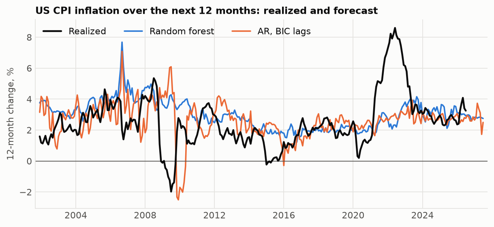
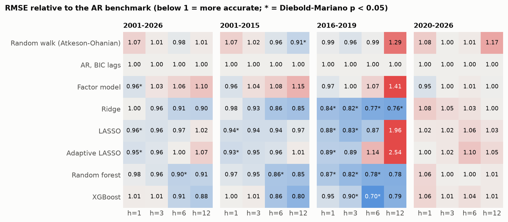
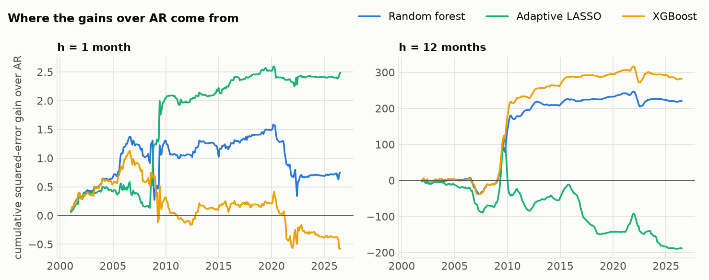
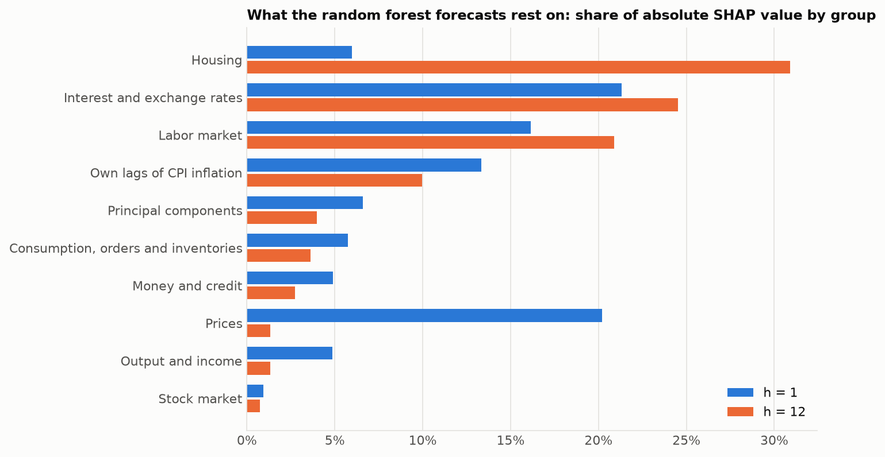
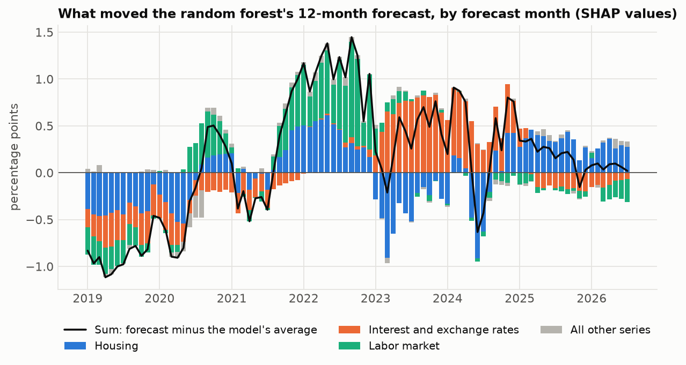

# ml-inflation-forecasting

[English](README.md) | **简体中文**

[](https://github.com/jackieyangjq/ml-inflation-forecasting/actions/workflows/ci.yml)

机器学习预测美国通胀，能比简单的自回归模型更准吗？本仓库用 Python 和最新的 FRED-MD 数据，复现了 Medeiros、Vasconcelos、Veiga 和 Zilberman（2021）发表在 *Journal of Business & Economic Statistics* 上的论文《Forecasting Inflation in a Data-Rich Environment: The Benefits of Machine Learning Methods》的实验设计，并做了两点扩展：检验期延长到 2026 年 7 月，覆盖疫情和 2021–2023 年的通胀飙升；树模型和 LASSO 的每一次预测都附带 SHAP 分解，说明是哪几类指标在推动预测。



## 结果

预测起点为 2000 年 12 月至 2026 年 7 月的每个月，共 308 个；8 个模型，4 个预测期。下文的数字都是各模型相对 AR 基准的 RMSE（均方根误差）比值：0.85 表示预测误差比 AR 低 15%。

- **在论文自己的检验期上，论文的主要结论成立。** 2001–2015 年，用全部 121 个指标的模型在 6 个月和 12 个月预测期上胜过 AR：12 个月预测中，XGBoost 的 RMSE 低 20%，随机森林和岭回归低 15%。两个树模型在 6 个月和 12 个月上，Diebold-Mariano 检验都在 10% 水平上拒绝"与 AR 一样准"（随机森林 6 个月达到 5% 水平）。
- **随机森林并没有压倒其他模型。** 论文认为它优于所有其他模型。这里它在 6 个月和 12 个月上属于最好的三个之一，与 XGBoost、岭回归不相上下，模型置信集无法把三者区分开。
- **12 个月预测的优势，大部分来自一段时期。** 2001–2015 年随机森林和 XGBoost 相对 AR 的 12 个月优势，约三分之二来自 2008 年年中到 2010 年年中做出的预测。2008 年 12 月，AR 把物价的暴跌外推出去，预测 2009 年通胀为 −2.5%；随机森林预测 3.5%，XGBoost 预测 2.6%；实际是 2.8%。
- **2020 年以后，没有模型胜过 AR。** 2020–2026 年所有比值都在 0.95 到 1.17 之间。2021 年 6 月，除随机游走外，所有模型都预测未来 12 个月通胀在 2.3% 到 3.1% 之间，实际是 9.0%。
- **稀疏线性模型在下个月的预测上最好，但预测期一长就不稳。** 2001–2015 年，LASSO 和自适应 LASSO 把 1 个月预测误差降低 6–7%（5% 水平显著）；但 2016–2019 年的 12 个月预测，它们的误差是 AR 的 2 到 2.5 倍。
- **随机森林依赖哪些指标，取决于预测期。** 预测下个月时，SHAP 绝对值占比最大的是利率与汇率（21%）、其他价格指标（20%）、劳动力市场（16%）和通胀自身的滞后项（13%）。预测 12 个月时，房地产（31%）、利率与汇率（25%）和劳动力市场（21%）成为主导，CPI 以外的价格指标降到 1%。



### 2001–2015 年：论文的第二个检验期

| 模型 | h = 1 | h = 3 | h = 6 | h = 12 |
|---|---:|---:|---:|---:|
| 随机游走（Atkeson-Ohanian） | 1.07 † | 1.02 † | 0.96 † | 0.91\*\* † |
| AR，BIC 选滞后阶数 | 1.00 † | 1.00 † | 1.00 † | 1.00 † |
| 因子模型 | 0.96 † | 1.04 † | 1.08 † | 1.15 † |
| 岭回归 | 0.98 † | **0.93\* †** | 0.86\* † | 0.85 † |
| LASSO | 0.94\*\* † | 0.94\* † | 0.94 † | 0.97 † |
| 自适应 LASSO | **0.93\*\* †** | 0.95 † | 0.96 † | 1.01 † |
| 随机森林 | 0.97 † | 0.95\* † | 0.86\*\* † | 0.85\* † |
| XGBoost | 1.00 † | 1.01 † | **0.86\* †** | **0.80\* †** |

每个预测期的预测数：h=1：180，h=3：178，h=6：175，h=12：169。AR 的 RMSE（百分点）：h=1：0.313，h=3：0.796，h=6：1.339，h=12：2.182。

### 2020–2026 年：疫情与通胀飙升

| 模型 | h = 1 | h = 3 | h = 6 | h = 12 |
|---|---:|---:|---:|---:|
| 随机游走（Atkeson-Ohanian） | 1.08 † | **1.00 †** | 1.01 † | 1.17 † |
| AR，BIC 选滞后阶数 | 1.00 † | 1.00 † | **1.00 †** | 1.00 † |
| 因子模型 | **0.95 †** | 1.00 † | 1.01 † | **1.00 †** |
| 岭回归 | 1.08 † | 1.05 † | 1.03 † | 1.00 † |
| LASSO | 1.02 † | 1.02 † | 1.06 | 1.03 † |
| 自适应 LASSO | 1.00 † | 1.02 † | 1.10 | 1.05 † |
| 随机森林 | 1.06 † | 1.00 † | 1.00 † | 1.01 † |
| XGBoost | 1.06 † | 1.01 † | 1.04 † | 1.01 † |

每个预测期的预测数：h=1、3、6、12 均为 79。AR 的 RMSE（百分点）：h=1：0.280，h=3：0.726，h=6：1.256，h=12：2.307。

加粗：该列最低。\* 和 \*\*：相对 AR 的 Diebold-Mariano 单侧检验，p < 0.10 和 p < 0.05。†：在 90% 模型置信集内。2001–2026 年和 2016–2019 年的表见 [results/tables/summary.md](results/tables/summary.md)，全部数字见 [results/tables/accuracy.csv](results/tables/accuracy.csv)。

模型置信集几乎在每一列都保留了几乎所有模型：12 个月预测的误差相互重叠，又有一段时期占了大头，15 年的月度数据不足以在 90% 置信度下给模型排出名次。逐个模型与 AR 的两两检验更敏锐，读表时应以它为准。

### 优势从哪里来



曲线上升表示该模型在那段时间胜过 AR。12 个月预测中，树模型的大部分收益来自 2009–2010 年，之后到 2020 年略有增加，2021–2022 年吐回一部分；自适应 LASSO 在 2015 年后一路落后。

### 是什么在推动预测





2021 年上半年，低利率把随机森林的 12 个月预测压在平均水平以下；劳动力市场和房地产指标直到 2021 年下半年才把预测往上推，而那时 12 个月通胀已经超过 5%。2023 年，加息成为推高预测的主要因素。这些是各指标对模型预测的贡献，不是因果效应。

### 2026 年 7 月做出的预测

2026 年 8 月至 2027 年 7 月的 CPI 通胀（12 个月对数变化，单位为百分比）：AR 2.5，随机森林 2.8，XGBoost 3.3，自适应 LASSO 2.0，随机游走 3.3。鉴于 2020–2026 年的表现，这些预测都不比 AR 更值得信赖。

## 数据

[FRED-MD](https://www.stlouisfed.org/research/economists/mccracken/fred-databases)（McCracken 和 Ng，2016）是圣路易斯联储维护的美国宏观月度数据库，约 126 个指标，涵盖产出、就业、房地产、订单、货币与信贷、利率与汇率、价格和股价。本仓库使用 2026 年 8 月版，数据从 1959 年 1 月到 2026 年 7 月。`inflation-ml download` 负责下载，数据文件不放进仓库。

| 步骤 | 做法 | 原因 |
|---|---|---|
| 变换 | 每个指标按 FRED-MD 指定的方式变换成平稳序列（差分、对数差分等）。CPI 取对数差分，所以预测目标和它的滞后项就是通胀本身 | 这个数据库的标准做法 |
| 预测目标 | 未来 h 个月的通胀，`100 * (log CPI[t+h] - log CPI[t])`，h = 1、3、6、12 | h = 12 即未来一年的通胀 |
| 单月缺失 | 用前后两个月做对数线性插值：2025 年 10 月的 21 个指标（联邦政府停摆，CPI 和住户调查停发），以及 2020 年 4 月的两个商业票据利率 | 否则会缺两个月的通胀 |
| 缺口更长的指标 | 剔除 ACOGNO、ANDENOx、TWEXAFEGSMTHx、UMCSENTx、VIXCLSx，剩 121 个 | 它们 1960 年以后才开始，或早期只有季度数据 |
| 异常值 | 偏离中位数超过 10 个四分位距的值，换成上个月的值；中位数和四分位距只用 1960–2000 年计算（共替换 179 个值） | McCracken-Ng 的规则，改成只看过去。通胀本身不做清洗 |

## 方法

从 2000 年 12 月到 2026 年 7 月的每个月 T（共 308 个预测起点），每个模型都用截至 T 的 480 个月（40 年）数据重新估计，再预测未来 1、3、6、12 个月的通胀。采用直接预测：每个预测期单独一个模型。T 以后的数据一概不用，主成分也在每个窗口内重新估计；`tests/test_models.py::test_no_look_ahead` 会改写 T 之后的数据，检查预测是否保持不变。

预测变量与论文相同：121 个指标和面板前 4 个主成分，各取 4 期滞后（t、t-1、t-2、t-3），每个窗口约 460 个观测、500 个变量。

| 模型 | 设定 |
|---|---|
| 随机游走 | Atkeson 和 Ohanian（2001）：过去 12 个月的平均月通胀乘以 h |
| AR（基准） | 对通胀做直接 AR(p)，p 从 1 到 12 由 BIC 选择 |
| 因子模型 | Stock 和 Watson（2002）的扩散指数：用 4 期通胀滞后和 4 个主成分做 OLS |
| 岭回归 | 全部预测变量，惩罚力度由 BIC 选择，自由度取帽子矩阵的迹 |
| LASSO | 全部预测变量，用 LARS 求精确路径，惩罚力度由 BIC 选择 |
| 自适应 LASSO | Zou（2006）：第一步 LASSO 的系数给出权重 1 / (\|b\| + 1/sqrt(n))，再做一次 LASSO |
| 随机森林 | 500 棵树，每次分裂随机尝试三分之一的变量，叶子至少 5 个样本（论文设定） |
| XGBoost | 1000 轮，学习率 0.05，深度 4，每层用 2/3 的变量（论文设定） |

准确度用各模型相对 AR 基准的 RMSE 衡量。Diebold-Mariano 检验判断某个模型的平方误差是否显著低于 AR，采用 Harvey、Leybourne 和 Newbold 的小样本修正，并用 Newey-West 方差处理多步预测误差之间的重叠。模型置信集（Hansen、Lunde 和 Nason，2011；分块自助法，90%）是与最优模型在统计上无法区分的那组模型。

随机森林和 XGBoost 中，每个变量对每次预测的贡献是它的 SHAP 值（精确的 TreeSHAP 算法）；线性模型中是系数乘以标准化后的变量值。贡献先按指标的各期滞后加总，再按 FRED-MD 的八大类加总。

### 与原论文的差异

| | Medeiros 等（2021） | 本仓库 |
|---|---|---|
| 数据 | FRED-MD，1960–2015 | FRED-MD 2026 年 8 月版，1960–2026 |
| 检验期 | 1990–2000 和 2001–2015 | 2001–2015（同论文第二个检验期）、2016–2019、2020–2026 |
| 预测目标 | CPI 和 PCE 通胀；未来 1 到 12 个月的月通胀，以及 3、6、12 个月的累计通胀 | 只做 CPI；每个预测期的累计通胀各用一个模型直接预测 |
| 模型 | 20 多个，包括完全子集回归、目标因子、bagging、神经网络、贝叶斯 VAR 和随机森林混合模型 | 8 个 |
| 主成分 | 基于去均值的面板 | 基于标准化的面板 |
| 虚拟变量 | 通胀最低的月份（2008 年 11 月） | 无 |
| 解释 | 全样本的变量重要性 | 每一次预测的 SHAP 值，按类别汇总 |

数据用的是修订后的最终版本，不是预测者当时实际拿到的数据；原论文也是如此。

## 局限与下一步

- **修订后的数据。** 每次预测用的都是今天修订过的数据，而不是当时公布的数据。FRED-MD 保存了 1999 年 8 月以来的每月版本；让每个预测起点只用当时的版本，才能看出预测者当时真正能做到什么，优势很可能会缩小。
- **没有在检验期上调参。** 随机森林和 XGBoost 沿用论文设定，线性模型在每个窗口内用 BIC 选惩罚力度。换别的设定也许在 2001–2026 年上更好看，但看着这段时期挑设定，会夸大模型的真实能力。
- **只有一个预测目标。** 只做了整体 CPI；论文还预测了 PCE 通胀，核心通胀也值得加上。
- **贡献不是因果。** SHAP 值说明的是拟合出来的模型怎样使用各个指标。相关的指标之间如何分配贡献取决于模型，所以"房地产很重要"的意思是房地产数据里有有用的信号，而不是房地产推动了通胀。

## 运行

```bash
pip install -e ".[dev]"
inflation-ml backtest   # 下载 FRED-MD，在每个预测起点重新估计所有模型（10 核约一小时）
inflation-ml evaluate   # 生成 results/tables/accuracy.csv 和 summary.md
inflation-ml figures    # 生成 figures/*.png
pytest -q
```

预测结果和 SHAP 贡献已经放在 `results/` 里，所以不下载数据、不重新估计也能运行 `evaluate` 和 `figures`。已存在的预测文件不会重算：删掉它或加 `--overwrite` 即可重跑。`--models` 和 `--horizons` 可以只跑一部分，例如 `inflation-ml backtest --models ar lasso --horizons 12`。

## 目录结构

```text
src/inflation_ml/
  data.py        下载数据版本、变换、补缺、清洗异常值
  features.py    预测目标、滞后项、窗口内的主成分
  models.py      八个模型、BIC 调参、贡献分解
  backtest.py    滚动窗口预测，可断点续跑，并行计算
  evaluate.py    RMSE 比值、Diebold-Mariano 检验、模型置信集
  plots.py       作图
  cli.py         inflation-ml download | backtest | evaluate | figures | all
figures/         上面的五张图
results/
  forecasts/     每个模型、每个预测期一个 csv：预测起点、目标月份、预测值、实际值
  contributions/ 各指标对每次预测的贡献
  tables/        accuracy.csv、summary.md
tests/           基于模拟数据的测试：变换、补缺、无前视、BIC LASSO、DM 检验
```

## 参考文献

见[英文版](README.md#references)。

## 许可

代码采用 MIT 许可。FRED-MD 由圣路易斯联储发布，使用时请引用 McCracken 和 Ng（2016）。
